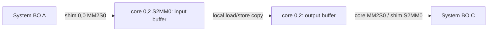

# Device-transfer mechanism and guarded completion costs (v15)

This stage keeps performance/placement search paused and leaves CGRA's existing
ML II model, conversions, mapper and scheduler unchanged. It preserves the v14
sync model and its 35/36 result, including the failed 2048-byte, n=23 cell.

The new result is a checked connection from public communication to **one actual
duplex device-copy path**, plus a narrowly scoped analytical completion-envelope
model. It is not a pure-DMA bandwidth model or a complete-program predictor.
Primary heldout accuracy is **8/9 cells**, MAPE **19.44%**; the failed cell stays
failed. Expanded performance search is not justified by this result.

## Path and completion

The input is a real Taskflow body `C[0,j] = A[0,j]`, with static, noalias,
identity-layout FP32 buffers. The existing generic analysis and mapping planner
build and check its ProgramGraph. A tile choice `[1,C]` produces R=E/C uniform
phases. No new Python planner or runtime is introduced.



The checked public graph requests R input and R output regions. Final AIE runtime
IR coalesces these into **two whole-tensor shim BD tasks**, while two cyclic core
BDs execute **2R local transactions**. Each view describes total payload 8E bytes;
these three views are not additive physical traffic. There is no memtile on this
path. Two local buffers use 8C payload bytes (at most 16 KiB here); the existing
24 KiB budget is unchanged. Locks constrain buffer reuse, and a later input may
overlap a prior output through the distinct buffers/channels. Neither overlap nor
physical DDR traffic was measured.

The output-token await precedes input-task release and wrapper reconfiguration.
Successful runtime wait therefore supplies the captured execution's logical
completion evidence. Host visibility still requires the separate FROM sync.
BO reuse, host cache maintenance, device DMA, and core load/store are different
operations. Caller-bound system BOs eliminate extra runner staging on this path;
they do not eliminate device transfers.

## Common plan and backend binding

`include/Taskflow/DeviceTransferCost.h` adds a target-cost view of the existing
`GenericMappingPlan.communication` ProgramGraph, not a second program graph:

| Interface | Consumer and contract |
| --- | --- |
| `collectDeviceTransferFacts` / `checkDeviceTransferFacts` | Recheck source body, regions, versions/copies, endpoints, resources, uniform phases, and descriptor payload equality. |
| `deriveDeviceTransferBackendBinding` in `DeviceTransferAudit.h` | Read actual generic-form final AIE IR; validate source/graph/plan attributes, ABI, flows/channels, cyclic core BDs, whole-tensor runtime BDs and completion token. |
| `evaluateDeviceTransferCost` | Match exact architecture, implementation, runtime, toolchain, path, observer, condition and size domain; return predicted or unknown, covered events, resource reservations and model-file SHA. |
| `taskflow-transfer-opt` | Rebuild the checked graph from original MLIR/config, derive the backend witness, and export graph/facts/binding/witness/receipt/cost. |

Source/destination memory IDs, transfer links and resource IDs come from the
existing target memory binding. `host_to_l1` / `l1_to_host` remain compatibility
direction names in this narrow backend view; they do not create a new public
memory architecture. Parameters are supplied with `--cost-model`, or target-config
top-level `device_transfer_model`. This evaluation-only key does not alter the
source, native plan or ProgramGraph identity. Explicit CLI selection takes priority.

The final-IR audit and ELF SHA are joined by the saved compile commands and
artifacts. This is structural compiler evidence plus successful execution, not a
hardware counter proof of every post-lowering physical transaction.

## Frozen model and accounting

For the matched duplex-copy path only:

```
T_completion_ns = 219391.94444444464 + 2.636321779281373 * B
B = input_runtime_descriptor_bytes + output_runtime_descriptor_bytes = 8E
```

The label is actual start-API entry through successful original-runtime wait
return. It includes local copy, DMA, locks, configuration, stalls, runtime and
polling together. Parameters are calibrated with nonnegative least squares on
nine equally weighted training-cell medians; this is calibration of a guarded
path-envelope formula. Neither coefficient is identified as pure configuration
latency, pure DMA time or DRAM bandwidth. Two runtime descriptors are constant,
so a separate descriptor coefficient cannot be identified. `segment_ns=0` means
the independent term is omitted, not that physical transactions are free.

Domain: 32,768–524,288 total requested bytes, 3–1024 uniform segments, 64–2048
FP32 elements per tile, continuous aligned transfers, scalar single-core copy,
nine prepared contexts, fixed bound-BO minimal observer and 200 us polling.
The model and runtime-condition files bind the exact identities. Separate
one-way paths, arithmetic, nonuniform tails, strides, other contexts or observers
are not covered. Out-of-domain queries remain unknown or reject an invalid
backend witness; they do not silently produce zero.

The composite owns native DMA, copy computation, submission and completion once.
Adding another price for these events is rejected. Resources `npu.dma`,
`npu.compute` and `host-submission` are conservatively reserved for the interval;
these are scheduling abstractions, not measured engine utilization. BO sync,
input reset, output copy and outside-interval host work are excluded. V14 sync
coefficients cannot be transferred to the new observer/context/ABI condition.
Complete-program cost and physical bytes remain null.

## Evidence and independent validation

Before fitting, calibration was fixed to E={4096,16384,65536},
C={64,256,1024}; heldout to E={6144,24576,49152}, C={128,512,2048}.
The unseen three-segment case and C=2048 are declared extrapolations. Each split
has three seeds, two warmups and nine hot repetitions per case: **297 executions**.
All calibration and heldout outputs are exact copies under independent FP32 and
float64 checks. Inputs change every call; outputs are poisoned beforehand.

Primary frozen model SHA:
`cc02bfdf882f621fc0bc78f3d9b69a2d5c7c63978237e840cb78d000f124d9ab`.
Heldout passes 8/9 predeclared median thresholds
`abs(error) <= max(300000 ns, 0.25 * measured_median)`.
E=49152,C=128 predicts 1.256036 ms versus 1.757572 ms, error 0.501536 ms,
above its 0.439393 ms threshold. Small cells have about 34% relative error even
when inside the absolute floor. Only 198/243 hot individual samples meet the same
cell rule; four of 27 seed medians fail. This is not a confidence guarantee.
Per-seed training slopes vary 2.60–4.13 ns/byte. No outlier deletion or heldout
refit occurs. Differences below 300 us do not support candidate ranking.

The minimum legal copy (16 elements) is not an empty kernel and is not subtracted
as launch overhead. Fixed-payload/different-segmentation and four-add computation
controls do not support separately identifying chunk startup or pure compute.
A nonuniform E=320,C=256 copy passes three real NPU seeds but is explicitly outside
this cost model.

A bounded standard-toolchain shim DMA trace on/off experiment validates ten copy
outputs, but every 4096-word trace capture is zero. No device timestamp, duration,
trace completeness, or pure-DMA claim follows. The generated control sequence
stops tracing then immediately reconfigures, without a separate trace-drain await;
this is a plausible unresolved explanation. Original trace failures and raw words
are preserved. A verified drain/flush and complete DMA start/end observations are
needed before splitting this envelope further.

## Entry points

Compiler-only checks use independent Core without AIR/AIE/XRT/Neura linkage:

```sh
LLVM_BUILD=/home/shiran/project/llvm-project/build \
  bash scripts/build-core.sh /absolute/new-core-build
```

One bound public communication query:

```sh
taskflow-transfer-opt source.mlir --target-config config.json \
  --final-aie final.generic.mlir --artifact hardware/program.elf \
  --runtime-binding binding.json --cost-model model.json --output /absolute/new-query
```

`final.generic.mlir` is the real compiled `npu.input.air.mlir` printed with the
installed `aie-opt --mlir-print-op-generic`. All outputs must be new directories.

Full measurement/freeze/heldout replay of SHA-bound compiled packages is in
`../orbit-artifact/taskflow/scripts/run_device_transfer_v15.sh`; it accepts explicit
protocols, binding and C++ facts indices, and never replans/compiles in Python.
The companion `results/taskflow/device-transfer-v15/RESULTS.md` records the exact
clean-shell command, source/tool identities, raw samples, failures and regressions.
The path audit is `taskflow/docs/taskflow-device-transfer-path-v15.md` there.
