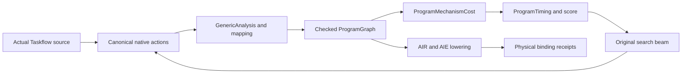

# Public execution groups and assumption-driven search, v18

ORBIT evaluates one checked `ProgramGraph` across source transformations,
search, cost-feature extraction and AIR lowering. The v18 extension makes local
producer/consumer block retention an explicit public decision and permits an
explicitly assumed event model to guide the original C++ search. It does not
replace the Amoeba mapper, scheduler, network algorithms or CGRA ML model.

Three conclusions must be evaluated separately:

1. **Algorithmic estimation loop:** declared parameters produce event schedules;
   those scores select parents and therefore change the second search round.
2. **Real candidate ordering:** measured differences must resolve the candidates
   and agree with the predicted ordering under stated execution conditions.
3. **Measured speedup:** a candidate must improve the measured baseline within
   the reported measurement resolution and correctness conditions.

The CPU search evidence establishes the first conclusion. Physical-plan
correspondence additionally requires both identity joins and a legal actual
execution topology, including the block-release correction described below. It does not establish either hardware
ordering or speedup. Device results belong in the companion v18 results report.

## One graph, three responsibilities

`GenericAnalysis` borrows the actual Taskflow operations, accesses, loop domains
and dependence facts. Native source actions are materialized before analysis;
they are not annotations on an unrelated performance graph.

`GenericMappingPlan` realizes the selected ordering, implementation, storage
policy and target bindings. `buildProgramCommunication` derives logical
regions/versions, physical allocations/copies, their creators and users, actual
transfer requests and execution dependencies. `finalizeProgramGraph` attaches
source task instances, execution groups and invocation lifecycle boundaries.
The common checker validates that realization before it can be scored or
lowered.

`ProgramMechanismCost` prices activities in that same graph and delegates time
evaluation to `ProgramTiming`. AIR consumes the checked phases, public groups,
allocations/copies and transfer bindings. The backend emits and audits the
resulting AIR/AIE/ABI realization. BD, FIFO and lock details remain backend
implementation evidence rather than new public graph primitives.



Semantic source dependencies, implementation groups and time annotations remain
separate. In particular, batching independently checked tiles cannot remove a
pure-order whole-task dependency. A logical data dependency is not charged as
an independently additive transfer. A retained local copy can satisfy several
consumer edges, and the backend may merge several physical delivery requests
into fewer runtime BDs.

## Public source decisions

`ProgramMappingChoice` keeps the existing residency and data-organization
fields and adds optional `taskGroup` and `retainedStorages` vectors of analyzed
source-object indices. Canonical `orbit.mapping` attributes spell these fields
`task_group` and `retained_storages`. Empty fields are omitted. These are public
data and execution choices, independent of a workload name or arithmetic
operation spelling.

| Grouping | Checked meaning | Current native realization |
|---|---|---|
| `task-shape-stages` | Existing task-major tile order | Existing `serial-tiled` behavior |
| `shape-major` | Batch independent equal-shape tiles within each source task | Materialized intermediate remains a host BO |
| `tile-major` | Execute corresponding producer and consumer instances before advancing the spatial block; batch independent blocks by shape | A selected temporary has one local copy shared by its consumers |
| `whole-program` | Existing capacity-checked full-program residency | Existing `single-herd-resident` behavior |

The new tile-major realization initially requires a complete closed source task
group, exactly one writer for each selected temporary and actual readers. All
tasks must have matching static spatial grids and all accesses to retained
storage must exactly match the corresponding producer region. The existing
loop independence proof examines reads as well as writes. In-place updates,
reductions, panels, repeated non-tile work, mismatched grids, duplicate storage
selection and pure-order barriers are rejected. A consumer outside the group
is excluded by the closed-group restriction; it is not silently deprived of a
materialized boundary.

The discovery API proposes the grouping and retention candidates from actual
task accesses and temporary storage. The original `runStructuredSearch` driver
applies each canonical source action, replans and checks it, and records rejected
proposals. Tiling and grouping can compose across two rounds. Python launches
the driver and audits artifacts; it does not generate a separate plan, decide
legality, compute scores or select a beam.

## Physical copies, owners and groups

`MappingAllocation.addressing` distinguishes `region-addressed` storage from a
`reusable-slot`. Host BOs use logical region offsets within a full allocation;
a reusable local slot aliases successive logical regions at the same physical
address. `spatialOwner` denotes a concrete physical instance. The current
validated native binding is the single tile `npu.tile(0,2)`, not a resource-pool
name. Other spatial placements require an explicit backend binding extension.

`ProgramExecutionGroup` is a public type in `ProgramMapping.h`.
`ProgramGraph.executionGroups` is authoritative and serialized into graph
identity. Each group records its phase interval, member events, resource,
memory, predecessor groups and spatial owner. The native plan keeps a checked
compatibility witness. A resident program explicitly has one group, so its
configuration cost cannot disappear merely because it has no tiled stages.

Source phase indices bind computation and transfer instances; they are not
execution-order timestamps. In a native multi-task tile group, the core executes
all producer/consumer computations before releasing its input-free and
output-ready locks. The public event order therefore places the block computes
before its deferred exports. Both exports depend on the last compute. The next
input delivery may proceed after that core release without waiting for both
previous exports; the next core block waits for its own input and both previous
output slots. Copy overwrite dependencies cover all previous readers. This
partial order is explicit in the common graph and must be checked against the
actual lowered lock/DMA order, rather than inferred from matching graph metadata
alone. Earlier phase-frontier chains incorrectly made B's export a predecessor
of C's compute; their old graph/search artifacts are preserved as superseded.

The selected temporary uses the same existing local data pool for its producer
and all consumers. The graph records one version/copy for the block, its two
users and its release/overwrite ordering. Its host allocation and transfers are
absent. `host_buffers` is derived from actual graph host-memory allocations;
source arguments retain their ABI positions. The lowerer cannot invent a host
BO for a local-only temporary or skip a consumer when emitting a multi-task
group.

`releasedAfter` is a half-open validity boundary in the topological event
witness. When it equals the next copy's creating/overwriting event, it must not
be translated into a wait for the unrelated event at ordinal `releasedAfter-1`.
Overwrite timing depends on the old creator and all actual readers, together
with explicit backend release dependencies. A separately modeled release event
can impose its own dependency. This distinction is necessary to preserve the
input-refill partial order through both graph construction and time evaluation.

Public buffer ordering derives slot-reuse dependencies from copy lifetimes.
The capacity checker and time evaluator respect physical aliasing, concrete
owners, release events, resource capacity and group implementation barriers.
Submission lifecycle is explicit: visibility to device, one submit, completion
and visibility to host. Splitting an event ordinal interval alone does not
create two valid refined invocation lifecycles.

## Event mechanism provider

The existing `orbit.direct-air.cost.v1` configuration accepts
`kind="event-mechanism"`. `GenericMechanismTiming` adapts the configuration to
`ProgramMechanismModel`; the latter annotates the existing graph without
introducing another scheduler or configuration system. Parameters have values
or explicit unknowns, units and `calibrated`, `architecture` or `assumed`
provenance. Backend link defaults retain their actual provenance. An assumed
link value must not become an architectural fact through the adapter.

| Activity | Mechanism expression | Principal unresolved identification |
|---|---|---|
| Compute instance | startup + source operations × operation cost + source loads/stores × memory-access cost | Logical scalar source quantities are not an instruction simulator or isolated local-bank measurement |
| Explicit transfer | startup + payload / effective bandwidth | Request delivery, locks, local copies and runtime BD merging can be coupled |
| Execution-group configuration | one startup per explicit group | Configuration and stage effects need independent evidence before physical interpretation |
| Shared invocation lifecycle | submit, completion observation and visibility prices | Host polling and synchronization envelopes can remain composite |

The registered v18 model uses the same explicitly assumed parameters for every
program and candidate; it is not fitted separately to each total execution
time. The exact numeric table, units, sources, preset and scope are retained in
`model-assumptions-r1/`. `strict` mode never substitutes assumed values.
`estimate` mode may use them, but serializes all assumptions with the schedule.
Missing required mechanisms preserve unknown reasons, known work and timing
bounds rather than becoming zero-cost complete predictions.

`ProgramTiming` obeys dependencies, copy readiness, resource reservations,
capacity and overwrite constraints. It derives the finish time from the event
schedule and exposes critical-path/resource-wait predecessors. Group setup and
host lifecycle do not receive duplicate whole-call charges. The provider's
`event_timing` attachment has activity-exclusive charge ownership; the old
whole-command composite adapter is bypassed for this model kind.

Current bandwidth annotations are fixed-duration/effective-service assumptions,
not a validated fluid bandwidth-sharing model. Local copy lifetimes can be
conservative over a composite interval. Synthetic parallelism tests establish
checker and scheduler behavior; they do not demonstrate that the current native
lowering overlaps communication and computation on hardware.

## Checked examples and historical source distinction

The actual add diamond is `X=A+1; B=X+2; C=X+X`, with both consumers reading X.
Its 8192 elements occupy 131072 logical bytes over four storages, exceeding the
24576-byte local payload policy. Materialized 512-element tiles use 4096 local
bytes and request 196608 transfer bytes in three groups. Retained blocks use
8192 local bytes and request 98304 transfer bytes in one group. A 1024-element
retained block uses 16384 local bytes with the same transfer payload. These are
checked compiler facts, not measured timings or total physical memory usage.

The M65/N136 tail example batches four shape groups while retaining the block
producer/consumer sequence. It requests 106080 transfer bytes and at most 8192
local payload bytes. Stack and other backend nonpayload allocations remain
outside the public payload-budget accounting.

Two earlier fanout sources must not be conflated:

* The historical **measured v17 E768 plain fixture** is a RAW-only diamond. It
  has no pure-order edge. Its materialized shape-major control changes 48 to six
  groups with unchanged 18432 requested transfer bytes.
* The **repository `fanout-shared-v17.mlir` fixture** has an additional pure-order
  consumer dependency. With tile [1,48,1], shape-major changes 48 to six groups
  with unchanged 12288 requested transfer bytes and preserves its one pure-order
  edge. Tile-major is rejected for this source.

No historical source is altered to manufacture or remove the distinction.
The controls are generated by public C++ actions in the original search driver.
Their separate source hashes, graphs, plans and compile receipts are retained.

## Evidence and interpretation

All paths below are relative to companion
`orbit-artifact/results/taskflow/execution-graph-v18/`.

| Evidence | Established scope |
|---|---|
| `serial-group-dag-r1/grouping.stdout` | 41 grouping, release-order, alias and standalone-API checks |
| `final-clean-regressions-r4/REPORT.md` | Final env-i replay: Core38, combined55, AIR13/10/15, preserved original compiler17/CGRA8 and unfiltered lit35, all passed with unchanged tool hashes |
| `public-execution-audit-r1/timing-ordinal-release-r2.log` | 83 synthetic timing, capacity, lifecycle, ownership, multihop, copy-reuse and false-ordinal-barrier checks; not hardware timings |
| `estimated-search-r6/` | Final original two-round C++ search: 20 archived candidates, 17 assumption-priced candidates and actual score-selected second-round parents |
| `estimated-search-r6/strict-search/` | Same assumed parameter table under strict interpretation; explicit unknown absolute scores and empty ranking |
| `estimated-search-r6/compile-representatives.json` | Baseline, retained 512-element block, retained 1024-element two-action winner and materialized 1024-element control |
| `compiled-representatives-r4/` identity receipts | All four final source hashes, complete public graphs and native priced plans exactly match the original r6 search |
| `compiled-representatives-r4/` | Four fresh packages exactly match final full graphs and native priced plans; independent actual-AIE topology audit |
| `barrier-fanout-grouping-r1/`, `ordered-fanout-grouping-r1/` | Separate barrier and historical RAW-only shape controls |
| `tail-search-r1/` | Actual original-driver tail candidates and checked shape-group/traffic facts |
| `fresh-generate-r2/result.json`, `formal-r6-equivalence.json` | Fresh numerical source → original C++ search → four compilations → frozen tolerance protocol, zero NPU submissions; all four source hashes, full graphs and full priced plans equal formal r6 |
| `final-original-amoeba-cgra-r1/`, `final-original-lit-r1/` | Independent clean replay of preserved original compiler17/CGRA8 contracts and unfiltered35 lit tests |

Search feedback labels these scores `mechanism_estimate` with
`declared-event-mechanism-estimate` provenance and
`physical_hardware_measurement=false`. The registered model makes the original
beam select retention and then a larger retained block; this is an algorithmic
closed-loop demonstration. Whether those choices order real execution times
correctly, whether a measured candidate improves the baseline, and whether the
model is precise enough for optimization remain separate empirical questions.

## Clean-shell replay

Build production and public unit targets with `scripts/build-core.sh` in a new
build directory using the compiler recorded by the LLVM cache. That entry now
includes `taskflow-instance-grouping-test` and `taskflow-program-mechanism-test`.
Do not rebuild preserved v15-v17 toolchains or model-bound executables.

The compiler-only entry resets the environment, runs the full Core suite before
loading any AIR SDK environment, then loads the explicit existing toolchain for
AIR/legalization, original Amoeba/CGRA contracts and unfiltered lit discovery:

```sh
bash scripts/run-execution-graph-v18-cpu.sh \
  /absolute/fresh/core-build /absolute/fresh/air-build \
  /absolute/new/results \
  /home/shiran/project/orbit-artifact/builds/taskflow-v13/amoeba/tools/mlir-amoeba-opt/mlir-amoeba-opt
```

Every stage retains command, stdout, stderr and exit status. Before/after tool
hashes establish that this entry performs no builds. AIR pass tools, numerical
reference imports used by the preserved model contract and `not` are obtained
from the explicitly sourced SDK and LLVM paths. This entry never submits NPU
work. A failure keeps its complete partial output; restart in a new directory.

The score-driven CPU search can be repeated independently:

```sh
/usr/bin/python3 test/TaskflowGeneric/execution_graph_search_v18.py \
  --tool /absolute/fresh/core-build/tools/taskflow-opt/taskflow-opt \
  --source test/TaskflowAIR/fixtures/diamond-v18.mlir \
  --config /home/shiran/project/orbit-artifact/results/taskflow/execution-graph-v18/model-assumptions-r1/estimate-config.json \
  --output /absolute/new/search-results
```

For device replay, use the companion's fresh v18 **tolerance** probe/entry rather
than the retained failed exact-bitwise trial. The current arithmetic contract is
finite FP32 source-order and independent unrounded FP64 references with the
project's existing absolute/relative tolerance. The main agent supplies the
final SHA-bound protocol, compiled package index and small-device replay command;
all submissions acquire the existing `/tmp/npu.lock`. A protocol using the old
incorrect graph is historical evidence, not a repaired-graph replay.

Intermediate r3/r4 artifacts remain available for diagnosis; final r6 is the corrected search checkpoint. A later audit also
found that an overwrite validity ordinal had been converted into an unrelated
previous-event timing barrier, and that single-task materialized groups retained
the same incorrect phase frontier. The final serial-tiled rule applies to all
groups: explicit core order (including initialization), all-reader alias reuse
and a complete predecessor-group control frontier, with no within-group DMA
completion barrier invented from source phase. The final execution-graph/timing checkpoint must
include that correction and its targeted buffer-ordering tests. Its fresh search,
compile topology and regression receipts supersede intermediate identity-only
or synthetic-phase-order evidence; historical distributions remain untouched.

The companion entry supports a complete fresh generation chain as well as
read-only device replay. `generate` performs no NPU submissions: the fixture
supplies source and numerical references, C++ proposes/checks/scores/selects the
candidates, the existing compile wrapper builds the four actual source plans,
and the tolerance observer freezes their exact identities.

```sh
bash /home/shiran/project/orbit-artifact/taskflow/scripts/run_taskflow_execution_graph_v18.sh generate \
  --core-tool /absolute/fresh/core-build/tools/taskflow-opt/taskflow-opt \
  --air-tool /absolute/fresh/air-build/tools/taskflow-opt/taskflow-opt \
  --config /home/shiran/project/orbit-artifact/results/taskflow/execution-graph-v18/model-assumptions-r1/estimate-config.json \
  --output /absolute/new/generated-study
```

A small prepared-device replay consumes the resulting protocol or the final
study's frozen protocol. It refuses an existing output directory, verifies all
bound inputs before execution and leaves the frozen protocol unchanged. The
observer owns the existing device lock; the outer entry applies a 120-second
process timeout and uses the tolerance adapter by default.

```sh
bash /home/shiran/project/orbit-artifact/taskflow/scripts/run_taskflow_execution_graph_v18.sh npu \
  --protocol /absolute/frozen/protocol.json \
  --output /absolute/new/device-replay
```

Only the main agent runs this device command during a team session. A replay
protocol already informed by earlier observations is not an untouched holdout,
even when its parameters were never refitted. New-process stability, unseen-plan
generalization and a repeated implementation check must retain separate labels.

The final repaired checkpoint is `estimated-search-r6/` ->
`compiled-representatives-r4/` -> `observation-freeze-r5/`. The four plans have
independent bidirectional actual-AIE/public causal-order checks, including
materialized single-task groups and actual configuration transitions. Final
small-device entry replays are `npu-diamond-r6/` and `npu-diamond-r7/`; the main
agent serializes and reports those measurements separately. The historical
nonserial `single-herd-resident` lowering is not included in this new four-plan
bidirectional certification and must not inherit its validation claim.

The final complete clean-shell replay is `final-clean-regressions-r4/`: Core38,
combined55, grouped AIR13, prior organization AIR10, original AIR binding15,
preserved original compiler17/CGRA8 and unfiltered lit35 all pass. Its Core
unit groups include41 grouping,83 synthetic timing and19 mechanism assertions.
The optimizer used for the original backend contracts is the preserved binary;
the current Core adapter is tested against it, without rebuilding that backend.
The earlier r3 failure is retained: a stale test expected "cross-stage" where
the public metadata now says "cross-group". Only that string assertion changed;
all production tools have identical before/after hashes, and data/lifetime
checks were retained. `fresh-generate-r2/` independently recreates all four full
graphs and priced plans exactly equal to formal r6, then freezes a new protocol
without device submission.
