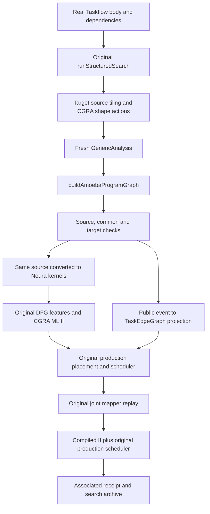

# Amoeba consumption of the public program graph

This stage preserves Taskflow computation and existing Amoeba algorithms while
moving the native evaluation seam onto the checked `ProgramGraph`. A program
candidate is its real source structure, resource choices and data organization;
the target determines how those requirements are realized. Different target
graphs need not have the same physical copies or graph identity.

## Audited migration boundary

| Responsibility | Legacy source | Public path |
|---|---|---|
| Task computation | Actual Taskflow, then route-expanded Neura kernel | Actual `graph.source` body through the same conversion passes, with bijective task lineage |
| Structural choices | Native joint actions and materializers | Original C++ search with target-provided source actions; each child is reanalyzed and replanned |
| Shape and replication | Original shape/replica algorithms | Initial public actions select rectangular CGRA shape; legacy replica algorithms remain available outside this finite bridge |
| Data requirements | `buildTaskEdgeGraph` from lowered operands/metadata | Checked region/version/copy and transfer events, projected by `buildTaskEdgeGraphFromProgramGraph` |
| Communication | `InterTaskNetworkSpec` plus route/reservation model | Same network/routing/reservations, with public transfer-event and ordering identities |
| Compute estimate | Existing route-expanded DFG features and CGRA ML catalogue | Same provider and cache, current task bodies and concrete PE rectangles |
| Placement and time | Production TaskScheduler | Same production pass, authoritative common dependencies and associated cycle schedule |
| Mapper | `MapJointSchedulingTasksPass` | Same actual mapper replay, separately recorded from ML prediction |

`JointNeighborhoodSearchPass` has an opt-in `decision-flow=program-graph` entry.
It supplies native hooks to the existing `runStructuredSearch`; Core contains no
Neura/model/runtime implementation dependency. Source SHA, common graph identity,
target/model evaluation identity, requests, action history and checked replay
continue to use the existing search archive/checkpoint mechanism.

`ProgramGraphAmoeba.cpp` holds the source module while building its graph, clones
that actual source through the original Taskflow-to-Neura pipeline, checks task
lineage and queries the unchanged cost provider. The production communication
factory consumes a scoped C++ graph reference. Its common path never invokes
legacy operand-based `buildTaskEdgeGraph`. Clones retain graph/task IDs and are
validated against that reference. The legacy factory remains available for
controlled differential evaluation and for existing users.

## Target contract and cost ownership

`AmoebaTargetContract` distinguishes the multi-CGRA block grid, the PE rectangle
inside each CGRA, and context slots per CGRA. Architecture and actual task-network
input identities participate in the graph and evaluation binding. Shapes retain
orientation and must satisfy the existing target/model protocols.

The current target does not specify physical SRAM byte capacities or a host-I/O
latency model. Public storage locations therefore denote abstract data
availability at task endpoints and the external boundary. `capacity_known=false`
and `capacity_bytes=null` preserve that fact; an internal integer ceiling only
guards arithmetic overflow. Allocation bytes/lifetimes remain inspectable, but
are not a claim of physical SRAM fit. No DMA engine or NPU payload budget is
invented for Amoeba. Direct AIR continues to require its known local budget.

Semantic transfer links have uncalibrated timing. Actual endpoint coordinates,
directed links, bottleneck bandwidth, latency and communication reservations come
from the existing network oracle. Its convention remains bits and cycles:
`path_latency + ceil(payload_bits / bottleneck_bits_per_cycle)`; a local route
uses the explicitly configured local bandwidth. Multiple requirements referencing
one copy do not create extra transfers. The initial finite bridge accepts
consumer-local phase copies; unsupported shared residency is diagnosed.

CGRA ML predicts mapper II in cycles for the current DFG and PE shape. Source
firing count is independently checked; duration retains the original
`ceil(startup_cycles + predicted_ii * (trip_count - 1))` conversion. Startup is
the existing structural estimate. It does not turn II into measured program
latency or certify physical local-memory service. Inter-task communication is
charged by the production network once. External supply/export and unmodeled
memory service remain explicit conditions, rather than zero-cost measurements.

The common `dependency-order-witness` policy validates the event partial order;
it does not substitute the old serial millisecond estimate for the spatial
backend schedule. Actual placement, context and communication occupancy are
solver results associated with common task/event identities. Predicted and
actual-mapper cycles remain distinct from direct-AIR host-call milliseconds.

## Exact regions and compatibility

The shared data-organization planner now optionally partitions storage at exact
source-access boundaries. Each cell has its own versions, availability copies,
creation transfers and lifetimes. This supports real constant-bound task tiles
without charging a full memref per tile. The previous whole-storage adapter is
still the default; native AIR keeps its existing arbitrary-rank region path.
The independent common checker is shared by these adapters.

The bridge initially requires byte-exact static memory bodies, one actual source
task per mapped instance, and a bijective conversion to mapper kernels. Its
bounded source tiling makes actual rectangular tasks and preserves write-state
ordering; shape choices change public resource demand. Before any rectangular
blocking, source analysis proves that every read and write of task-written storage
uses the same two distinct direct induction axes. The strict perfect nest has no
executable prologue; shifted accesses, repeated output cells and unsupported
loop-carried memory dependencies are rejected. This proof is independent of
arithmetic operator names. No arithmetic recipe is
used. Legacy Neura-only kernels, value/channel protocols, general replica and
arbitrary shared residency are not silently reinterpreted as supported source
interfaces.

`StaticCommunication` and its old `StaticPlan` callers still implement the legacy
2D static model. Their target types are reused, but their independent scheduling
algorithm has not been rewritten. Original Amoeba paths outside the opt-in
bridge remain intact. The bridge is the migration seam for future capabilities,
not a claim that every legacy source dialect or mapper mode has moved already.

Acceptance commands, actual candidate identities, legacy differences, numerical
NPU evidence and regression status are recorded in the companion
`taskflow/docs/taskflow-program-graph-amoeba-v12.md` and fresh v12 result directory.

## Concrete entry and consumer chain

The source and target APIs live in `include/Taskflow/ProgramMapping.h` and
`include/Taskflow/AmoebaMapping.h`; implementation is in
`lib/Taskflow/AmoebaMapping.cpp`. The actual opt-in driver is
`--search-joint-neighborhood='decision-flow=program-graph backend=amoeba ...'`.
`ProgramGraphAmoeba.cpp` binds the native Core search hooks;
`ProgramGraphCommunication.cpp` creates the authoritative adapter view.
`ProductionSchedulerAdapter.h`, `TaskCommunicationModel.cpp` and
`orchestration_utils.cpp` consume that view under an explicit scoped graph.

The acceptance architecture is a 4 by 4 fabric of CGRAs, each with 4 by 4 PEs
and 12 context slots. The input supplies 48 directed nearest-neighbor mesh links,
each with latency 1 cycle and bandwidth 32 bits/cycle; local channel bandwidth is
32 bits/cycle. Context slots are not byte capacity. `target-contract.json`,
common ledger, raw architecture and network hashes record both the public
abstraction and its concrete routing binding.

Predicted task durations feed the search score. A second production schedule
uses the actual mapper's positive compiled II, retaining the same startup and
source firing-count conversion. Both schedules, dependency/communication traces,
placements and controlled legacy comparisons are recorded separately. Neither
schedule is an Amoeba hardware or simulator timing measurement.

## Legacy differential and finite validation

On the delivered 4 by 4 add-to-scale source, untiled baseline and both oriented
shape candidates preserve the legacy dependency payload, placement and schedule
under identical durations. Predicted durations and compiled-II durations are
compared separately. Real rectangular source tiling creates eight Taskflow tasks,
not four labels attached to the original two tasks. The shared planner partitions
the logical regions into sixteen cells and rebuilds versions, copies and edges.

Legacy whole-value tokens associate all four scale tiles with the last add tile,
with four 512-bit transfers. The public source-region view associates each scale
tile with its actual producing add tile, with four 128-bit transfers, plus nine
zero-byte ordering edges. Both producer association and payload change. The
resulting 16-cycle legacy difference is a migration correction in the new opt-in
path; the old algorithm and its original callers remain available. It is not a
measured hardware speedup.

Source-valid does not mean every source has a legal realization in this finite
adapter. A cross-slice in-place read currently fails exact source/copy coverage
before model evaluation. A separate source with a harmless arithmetic prologue
has a legal baseline but is rejected by the conservative rectangular tile action.
The test suite distinguishes these two cases, in addition to source, target,
version, dependency, reachability, checkpoint-score and resume binding negatives.

Acceptance validates alternative whole-program backend realizations, not
simultaneous Amoeba/NPU coexecution or calibrated cross-target latency comparison.
