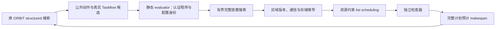

# 静态异构 mapping、通信与执行证据

> 历史 v3 说明：Python 规划器/检查器现已退出活动代码，旧差分仅为历史证据。默认生产与检查均为 C++/MLIR；复现入口为 `bash scripts/run_taskflow_static_cpp.sh NEW_OUTPUT_DIRECTORY`。v5 审计保留了退出前代码快照和全部旧结果。


本轮静态结果在 `build/static-mapping-v3/STATIC-RESULTS.md`，完整计划与搜索索引
在 `static-report.json`；硬件追加实验在
`../aie-toy/results/orbit-static-v3-hardware`。前两轮原始证据没有覆盖。

## 架构边界

公共 `orbit.taskflow.plan.v1` 和真实 Taskflow 物化保持不变。
`python/orbit_mapping` 只消费既有受限程序，生成独立的静态执行计划，
没有 Neura/AIR/XRT import 或链接依赖，也没有新计算语言或 runtime。



原驱动使用 `backend=static`，通过已有 evaluator 边界接入；没有第二套结构
搜索。每个候选重新映射，单位为 ms，反馈强制标记 `static_estimate` 与
`executed=false`。Amoeba cycles 与硬件 NPU ms 仍是不同评价域。
外层候选、内层计划、硬件/成本配置分别有身份；缓存覆盖程序访问、实现代码、
位置、布局、精度许可、硬件和成本。完整多文件配置测试发现并修复了原搜索
递归文件身份遍历顺序不稳定的问题：排序对象键后跨进程 resume 稳定。

任务内每个 fill、matmul、activation 都显式展开，融合不消除中间存储。
区域版本决定复用、copy、convert、sync；WAR/WAW/control 仅加顺序。
数据副本保守存活整图，计算及转换 scratch 按事件存活；共享资源按容量调度。
初始输入在声明位置已有效，单次冷图不免费假设额外权重副本。

完整字段及样例见 [版本契约](taskflow-static-contract.md) 和
[通信说明](taskflow-static-communication.md)。可验证配置样例位于
`build/static-mapping-v3/workloads/ffn_m128/config.json`，对应计划在
`base/mapping.json`。

## 成本与能力限制

主静态表是**理论敏感性场景**，不是本机预测精度的证明。CPU/NPU 仿射成本、
链路带宽和512 MiB NPU workspace预留均显式标明来源与范围。NPU内部精度转换、
padding及本地访存属于目标 task 成本；跨位置搬运和可见性同步另计。
实际 runtime 内存峰值没有被该预留认证。

复用的真实 NPU primitive 为 full-K、前置同区域零初始化的 GEMM，其他 K
partial 必须显式映射到支持累加的 CPU 实现。不存在 NPU ReLU/SwiGLU 实现，
不允许 mapper 选择它们。数值近似实现仅在源身份绑定的精度许可下可选。
缺失实现、未知成本、不可达路径、容量不足都留下未评分原因。

历史全图 NPU 实测不能拆成 compute-only 系数。新增 NPUChain 测量也保持为
经审计的完整区域 wall 成本：`taskflow_chain_model_v3.py` 描述两种后端执行
选择和精确适用身份，明确拒绝导入本轮 compute-only 模型，以免重复计费。
完整 FFN 的 CPU SwiGLU 会阻止该两GEMM链匹配；Gate/Up 合并是另一种实现选择。
这是当前静态 mapper 尚不能直接比较 opaque packed region 的明确限制。

## 验证与复现

独立 checker 不调用 mapper 或通信推导来认可计划；它从源程序重建访问、
版本及初始化要求，检查时序、资源、临时空间、峰值、输出可见性、身份和成本。
22项合成正例、28项重新签名的非法计划负例通过；两任务小图还与独立穷举
解析 oracle 比对。原 Core、Amoeba35项、搜索协议16项和缓存6项回归通过。
新静态搜索接入11项、目标推荐粒度4项通过。详见
[静态验证](taskflow-static-validation.md)。

以下完整静态入口已经从 shell 执行成功，重建、测试、四工作负载、两轮搜索、
缓存/恢复测试和报告都包含在内。输出目录必须不存在。

```bash
cd /home/shiran/project/orbit
bash scripts/run_taskflow_static_v3.sh "$PWD/build/my-static-v3-run"
```

若只重审已有结果，不访问设备：

```bash
source /home/shiran/project/aie-toy/scripts/env.sh
cd /home/shiran/project/orbit
python scripts/taskflow_static_report.py --output build/static-mapping-v3
```

硬件追加入口均复用已安装工具链和现有执行器。脚本自行持 `/tmp/npu.lock`，
不要额外套锁；团队执行须由一个负责人串行安排：

```bash
source /home/shiran/project/aie-toy/scripts/env.sh
cd /home/shiran/project/orbit
python scripts/taskflow_aie_trace_minimal_v3.py --output-dir /tmp/orbit-minimal-trace-new
python scripts/taskflow_npu_trace_v3.py --case all --iterations 7 --output-dir /tmp/orbit-graph-trace-new
python scripts/taskflow_npu_chain_v3.py --case all --iterations 7 --output-dir /tmp/orbit-chain-new
```

ORBIT trace 命令读取本机上一轮保存的原始 AIR 与输入，以同一 source 编译
trace-off/on；它不等于执行静态规划器输出的任意映射。原始trace、配置、
解析日志、事件对应和Perfetto文件由脚本保存。设备原生轴是cycle，主机轴
是相对ns，未进行时钟对齐。Perfetto的单位显示映射明确标注，不声称真实us。
完整性无法证明的trace一律标partial，不能把stall区间相加或把端口活动称DDR流量。

NPUChain 对照、精度、失败尝试和计时边界见
[chain说明](taskflow-chain-v3.md)，独立硬件证据检查见
[硬件审计](taskflow-hardware-evidence-validation.md)。

当前限制还包括：全图保守分配可能拒绝可通过复杂复用实现的方案；有界放置
与list scheduling不保证全局最优；仅同dtype布局转换，dtype转换、别名、动态形状、
多次执行预加载模型不支持。大K设备累加编译问题未改，新runtime未开发。
